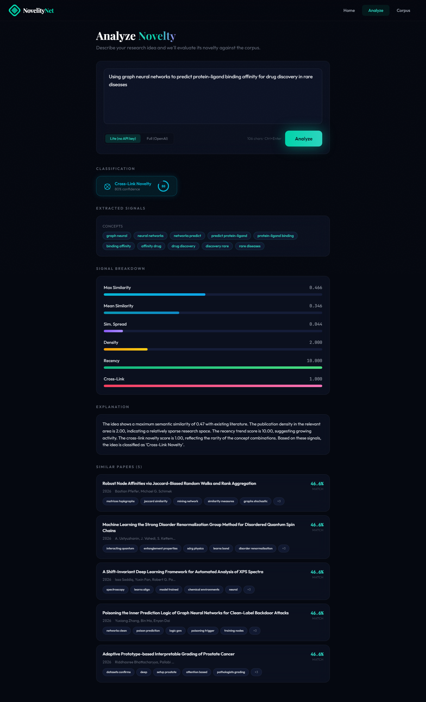
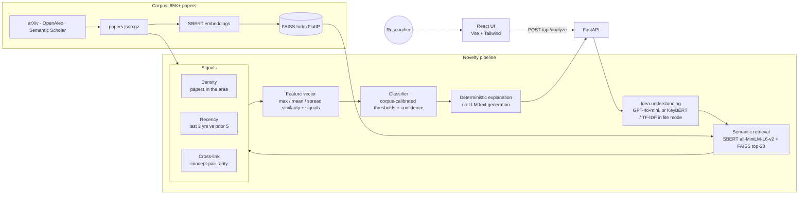
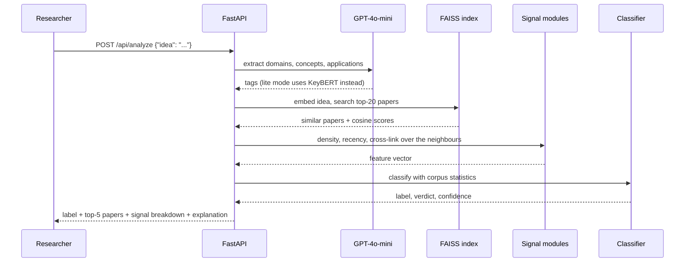

# NoveltyNet

**Multi-signal research novelty detection: is your idea new, incremental, or already done?**


NoveltyNet evaluates how novel a research idea is relative to a corpus of academic papers. It combines semantic similarity (SBERT + FAISS), publication density, temporal trend analysis, and concept co-occurrence rarity into a multi-signal scoring pipeline that produces an interpretable classification with a deterministic explanation.

Built over a curated corpus of **50K+ research papers** (65,263 AI/ML papers from arXiv, OpenAlex and Semantic Scholar), shipped as `data/papers.json.gz` and rebuilt with `scripts/fetch_bulk_corpus.py`.



## Quick start

```bash
pip install -r requirements.txt
python scripts/build_index.py          # unpacks data/papers.json.gz, embeds it -> data/index.faiss
uvicorn app.main:app --port 8000       # API + Swagger at http://localhost:8000/docs

cd frontend && npm install && npm run dev   # React UI at http://localhost:5173
```

---

## Motivation

Researchers and reviewers often need to quickly assess whether an idea is genuinely new, incremental, or already well-covered in literature. NoveltyNet provides a structured, data-driven answer by querying a local vector index of papers and returning a novelty label, confidence score, and explainable signal breakdown -- without relying on hallucinated model outputs.

---

## Novelty Categories

| Label | Meaning |
|---|---|
| **Independent Novelty** | Low similarity + sparse research area |
| **Cross-Link Novelty** | Moderate similarity + rare concept combinations across disciplines |
| **Direct Gap Fill** | High similarity -- incremental contribution to existing line of work |
| **Out-of-Domain** | Minimal similarity -- idea is outside the scope of the indexed corpus |
| **Uncertain Novelty** | Mixed or inconclusive signals |

---

## Key Features

- **Six-signal scoring**: max similarity, mean similarity, similarity spread, publication density, recency trend, and concept co-occurrence rarity
- **Hybrid classification**: rule-based thresholds over aggregated signals, fully deterministic, no hallucinations
- **Dual analysis modes**: full pipeline with OpenAI concept extraction, or lite mode using TF-IDF and KeyBERT for zero-cost testing
- **FAISS vector index**: normalized sentence embeddings with cosine similarity retrieval (IndexFlatIP)
- **Temporal awareness**: compares publication activity over the last 3 years vs. the prior 5 years to detect growing vs. saturated areas
- **arXiv integration**: fetch and index papers directly from arXiv search
- **Live corpus management**: add, upload, delete papers with automatic index rebuilding

---

## Architecture



### An analysis request



The five possible labels are **Independent Novelty**, **Cross-Link Novelty**, **Direct Gap Fill**, **Out-of-Domain** and **Uncertain Novelty**. If the idea is essentially the title of an existing paper, the verdict is overridden to *not novel*.

---

## Tech Stack

| Component | Technology |
|---|---|
| API Framework | FastAPI 0.110.0 + Uvicorn 0.29.0 |
| Embeddings | SentenceTransformers (all-MiniLM-L6-v2, 384-dim) |
| Vector Index | FAISS 1.8.0 (IndexFlatIP, cosine similarity) |
| LLM (optional) | OpenAI GPT-4o-mini (semantic concept extraction) |
| Concept Extraction | KeyBERT 0.8.0, scikit-learn TfidfVectorizer |
| Corpus Storage | JSON (papers.json) + binary FAISS index (index.faiss) |
| Data Science | NumPy, SciPy, Pydantic |
| Paper Fetching | arXiv API (XML) |

---

## Signal Definitions

### Similarity Signals
- **Max similarity**: closest paper in the corpus to the input idea
- **Mean similarity**: average distance across top-20 retrieved papers
- **Similarity spread** (std dev): consistency of matches; high spread suggests niche overlap

### Density Signal
Counts papers in the relevant area published within a 5-year window. High density indicates a crowded research area.

### Recency Signal
Ratio of publications in the last 3 years vs. the prior 5 years:
- Score > 1.0: growing area
- Score < 1.0: declining or mature area

### Crosslink Signal
Measures rarity of concept pair combinations across the corpus:

```
rarity(pair) = 1 / (1 + pair_count)
crosslink_score = mean(rarity) over all concept pairs in idea
```

A high crosslink score indicates the idea connects research threads that rarely appear together, a classic signal for interdisciplinary novelty.

---

## Classification Logic

```
if max_similarity < 0.15:
    label = "Out-of-Domain"

elif max_similarity < 0.45 and density < 2.5:
    label = "Independent Novelty"

elif 0.45 <= max_similarity < 0.80 and crosslink_score >= 0.6:
    label = "Cross-Link Novelty"

elif max_similarity >= 0.80:
    label = "Direct Gap Fill"

else:
    label = "Uncertain Novelty"
```

---

## Getting Started

### Prerequisites

- Python 3.9+
- OpenAI API key (optional, required only for full pipeline)

### Setup

```bash
git clone https://github.com/madhumanasa01/NoveltyNet.git
cd NoveltyNet
python -m venv .venv
source .venv/bin/activate
pip install -r requirements.txt

cp .env.example .env
# Set OPENAI_API_KEY (optional), DATA_DIR, etc.
```

### Populate Corpus

```bash
# Fetch papers from arXiv
python -m app.corpus.fetcher --query "graph neural networks" --max 100

# Or upload a JSON file via API
curl -X POST /api/corpus/upload -F "file=@papers.json"
```

### Run

```bash
uvicorn app.main:app --reload --port 8000
```

Interactive docs available at `http://localhost:8000/docs`.

---

## API Reference

| Method | Endpoint | Description |
|---|---|---|
| POST | `/api/analyze` | Full novelty analysis (OpenAI concept extraction) |
| POST | `/api/analyze/lite` | Novelty analysis with keyword extraction (no API key needed) |
| GET | `/health` | Service status and corpus size |
| POST | `/api/corpus/papers` | Add papers to corpus |
| POST | `/api/corpus/upload` | Upload a JSON file of papers |
| DELETE | `/api/corpus/papers/{id}` | Remove a paper by ID |
| GET | `/api/corpus/papers` | List corpus papers (paginated) |
| GET | `/api/corpus/status` | Index readiness and corpus metadata |

### Example Request

```bash
curl -X POST http://localhost:8000/api/analyze \
  -H "Content-Type: application/json" \
  -d '{"idea": "Using graph neural networks to predict protein folding pathways in drug discovery"}'
```

### Example Response

```json
{
  "idea": {
    "idea_text": "...",
    "domains": ["Bioinformatics", "Machine Learning"],
    "concepts": ["GNN", "protein folding"],
    "applications": ["drug discovery"]
  },
  "similar_papers": [...],
  "features": {
    "max_similarity": 0.61,
    "mean_similarity": 0.43,
    "density_score": 1.2,
    "recency_score": 1.8,
    "crosslink_score": 0.72
  },
  "classification": {
    "label": "Cross-Link Novelty",
    "confidence": 0.80
  },
  "explanation": "The idea shows moderate similarity to existing work but combines concepts that rarely appear together, suggesting a meaningful cross-disciplinary contribution."
}
```

---

## Corpus Paper Schema

```json
{
  "id": "arxiv_2301.12345",
  "title": "Paper Title",
  "abstract": "...",
  "year": 2023,
  "authors": ["Author Name"],
  "url": "https://arxiv.org/abs/2301.12345",
  "concepts": ["keyword1", "keyword2"]
}
```

---

## Project Structure

```
noveltynet/
├── app/
│   ├── main.py               FastAPI app + startup
│   ├── config.py             Environment settings
│   ├── corpus/
│   │   ├── loader.py         Load and save papers.json
│   │   ├── embedder.py       SentenceTransformer wrapper
│   │   ├── index.py          FAISS operations
│   │   ├── builder.py        Index construction and persistence
│   │   ├── fetcher.py        arXiv API client
│   │   ├── recency.py        Temporal trend computation
│   │   └── concepts.py       TF-IDF concept extraction
│   ├── core/
│   │   ├── idea.py           OpenAI semantic extraction
│   │   ├── similarity.py     Singleton embedder + FAISS search
│   │   ├── density.py        Publication volume scoring
│   │   ├── crosslink.py      Concept co-occurrence rarity
│   │   ├── features.py       Signal aggregation
│   │   ├── classifier.py     Rule-based classification
│   │   └── explanation.py    Deterministic explanations
│   └── routes/
│       ├── health.py
│       ├── novelty.py
│       └── corpus.py
└── data/
    ├── papers.json           Corpus storage
    └── index.faiss           Persistent FAISS index
```

---

## Environment Variables

```env
OPENAI_API_KEY=your_key       # Optional, needed for /analyze (full pipeline)
EMBEDDING_MODEL=all-MiniLM-L6-v2
DATA_DIR=data/
TOP_K=20
DEBUG=true
```

---

## License

MIT
